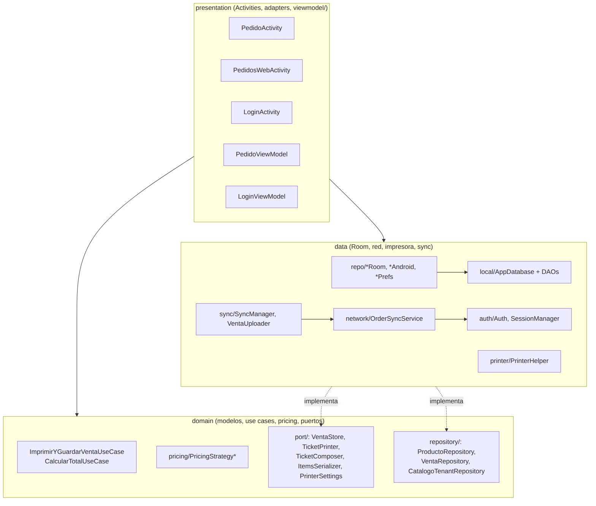
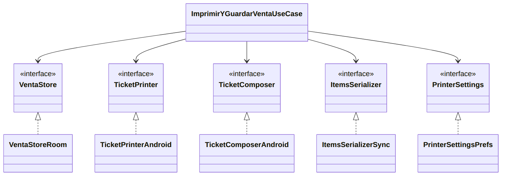

# SoftMYC TPV

TPV (terminal punto de venta) Android para tablet. Funciona **sin conexión**, imprime tickets en **impresora térmica ESC/POS** y permite que **varios negocios** convivan en el mismo dispositivo, cada uno con su propia base de datos. Es mi Trabajo de Fin de Grado.



## Qué hace

- **Cobro y pedidos** para distintos sectores (hostelería y otros), con un motor de precios universal: unidad, peso, tiempo y volumen escalonado.
- **Offline first:** las ventas se guardan en local y se sincronizan con el servidor cuando hay red.
- **Varios negocios por tablet:** una base de datos por negocio y control de acceso por roles.
- **Impresión térmica** de tickets por ESC/POS.
- **Seguridad:** bases de datos cifradas con SQLCipher, credenciales cifradas en el dispositivo y renovación de sesión ante caducidad del token.

## Tecnologías

| Área | Herramientas |
|---|---|
| App | Java, Android (Activities + XML, Material), Room (SQLite), OkHttp, Gson |
| Seguridad | SQLCipher, AndroidX Security Crypto, Android Keystore |
| Servidor | Node.js (Express), PostgreSQL 16, Docker |
| Calidad | JUnit 4, Mockito, Robolectric, JaCoCo, GitHub Actions |

## Arquitectura

Tres capas con dependencias hacia el dominio (`presentation` → `domain` → `data`), puertos y adaptadores para aislar la infraestructura, y un test que impide que la capa de presentación rompa esas reglas.



## Calidad

- **1.003 tests** unitarios en 125 clases, y 29 pruebas instrumentadas en tablet física.
- **90,5 % de cobertura** de líneas con JaCoCo (solo tests JVM).
- Migraciones de base de datos probadas una a una y integración continua en cada cambio.

## Probarlo

Necesitas JDK 17 y el SDK de Android 35.

```bash
git clone https://github.com/marcoscabrera-antolin/softmyc-tpv.git && cd softmyc-tpv
echo "sdk.dir=$ANDROID_HOME" > local.properties
./gradlew testDebugUnitTest assembleDebug
```

## Autor

**Marcos Cabrera Antolín** — [LinkedIn](https://www.linkedin.com/in/marcos-cabrera-antolin/)
