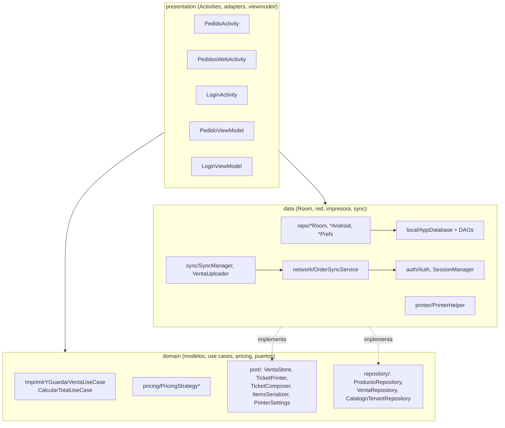
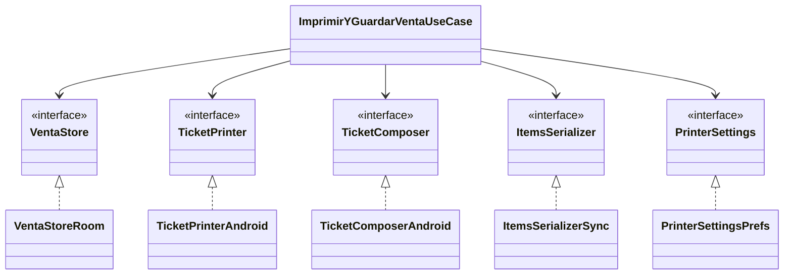
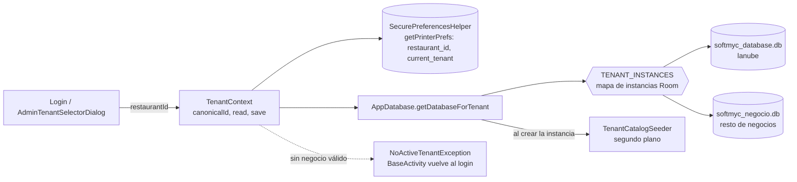
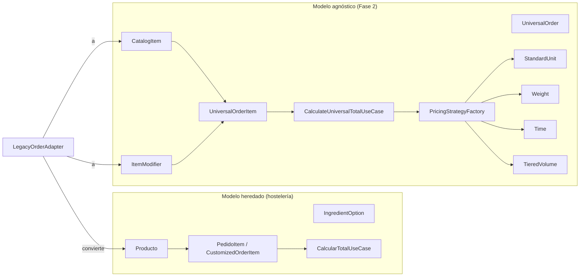
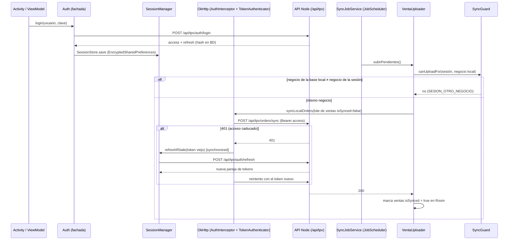
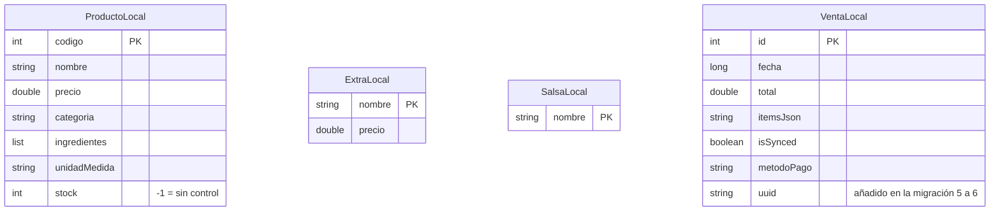
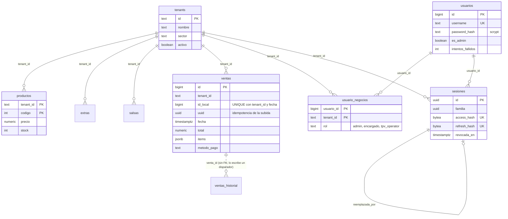

# Arquitectura de SoftMYC TPV (diagramas)

Diagramas en Mermaid (se ven en GitHub y en cualquier visor de Markdown con Mermaid). Cada nombre de clase existe en el código a fecha 16-oct-2026; las flechas de dependencia se han contrastado con `grep` de los `import` y llamadas citadas en cada sección. Fuente única: este fichero.

## 1. Capas y dependencias

Nota: `presentation` también depende de `data` (p. ej. `PedidosWebActivity` usa `OrderSyncService`); la inversión de dependencias solo está completa para el flujo de cobro (puertos de `domain/port`).

## 2. Puertos y adaptadores (inversión de dependencias del cobro)

## 3. Multi-tenant: una base SQLite por negocio

## 4. Motor universal frente al modelo heredado

## 5. Secuencia: sesión, renovación única y sincronización de ventas

## 6. Modelo de datos

### 6.1 Room (tablet, por negocio)

Las cuatro entidades no tienen claves foráneas: `VentaLocal.itemsJson` guarda el pedido serializado (ver `ItemsSerializerSync`). Room `version = 6`, migraciones manuales 1 a 6, sin `fallbackToDestructiveMigration()`.

### 6.2 PostgreSQL 16 (`tfg-db/initdb/`, multi-tenant por columna `tenant_id`)

También existen `api_keys`, `auditoria_auth` y `login_intentos_ip` (sin relaciones con otras tablas en el modelo) y las vistas `venta_lineas` y `ventas_diarias`. `ventas_historial` (SEG-API-02) guarda los valores anteriores de una venta reescrita; `venta_id` no es clave foránea (`tfg-db/initdb/08-api-seguridad.sql`).

## Limitaciones

- Los diagramas están exportados a SVG y PNG en `docs/diagramas/` (junto a su fuente `.mmd`), generados el 16-oct-2026 con `@mermaid-js/mermaid-cli` 11.4.2 y el Chrome del sistema. Para regenerarlos: `npx @mermaid-js/mermaid-cli -p puppeteer.json -i docs/diagramas/01-capas.mmd -o docs/diagramas/01-capas.svg` con `puppeteer.json` = `{"executablePath":"/usr/bin/google-chrome","args":["--no-sandbox"]}`. Si se edita este fichero, hay que mantener las `.mmd` sincronizadas.
- `graphify-out/GRAPH_REPORT.md` fue generado desde el commit `ec787fcb`, distinto del actual; no se ha usado como fuente.
