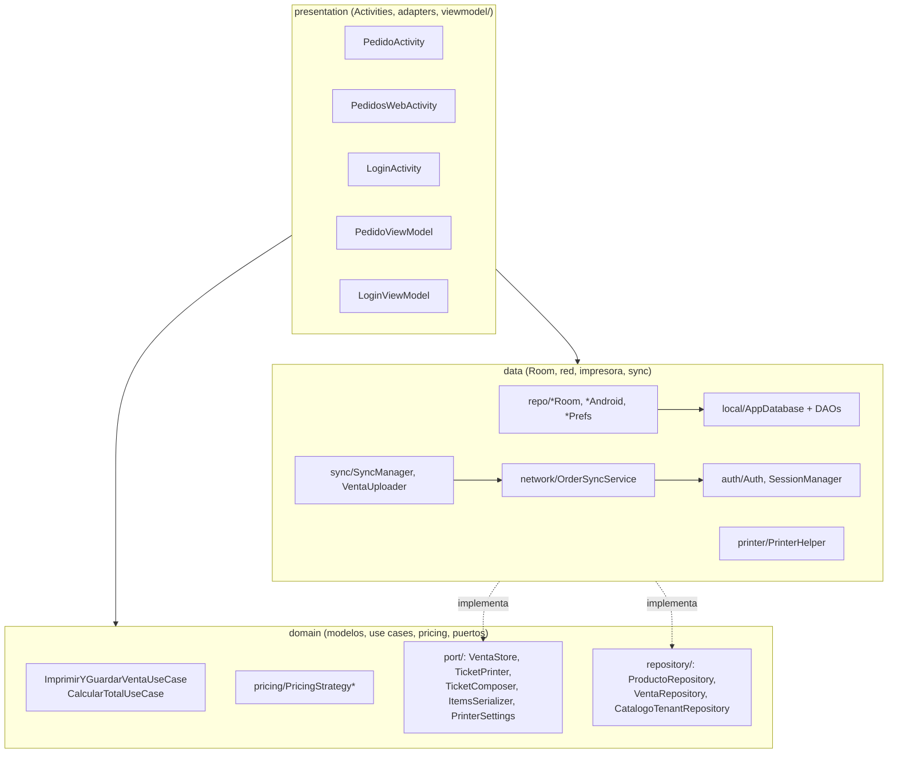
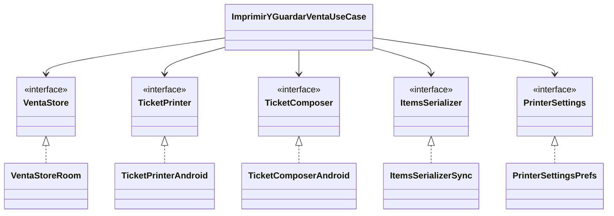
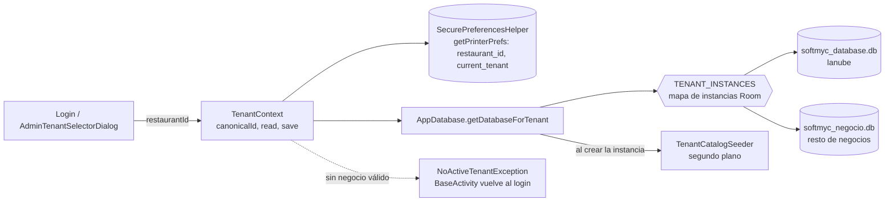
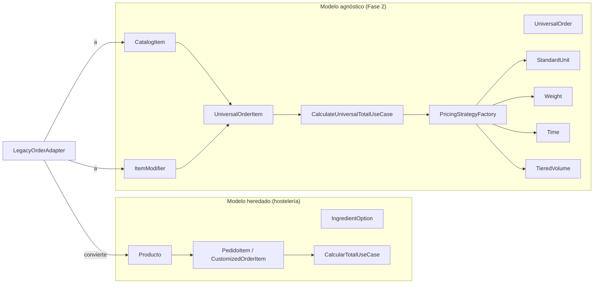
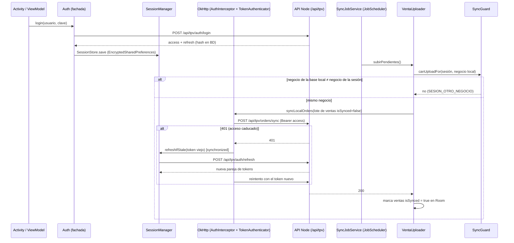
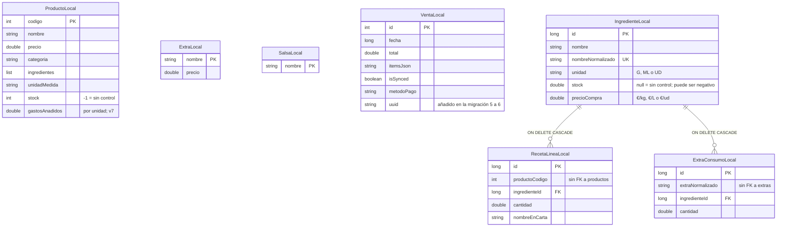
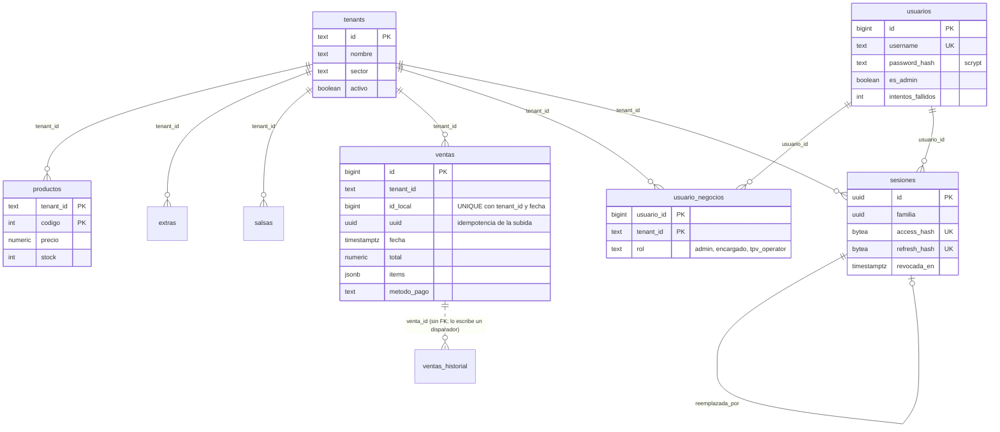

# Arquitectura de SoftMYC TPV (diagramas)

Diagramas en Mermaid (se ven en GitHub y en cualquier visor de Markdown con Mermaid). Cada nombre de clase existe en el código a fecha 16-oct-2026; las flechas de dependencia se han contrastado con `grep` de los `import` y llamadas citadas en cada sección. Fuente única: este fichero.

## 1. Capas y dependencias

Nota: `presentation` también depende de `data` (p. ej. `PedidosWebActivity` usa `OrderSyncService`); la inversión de dependencias solo está completa para el flujo de cobro (puertos de `domain/port`).

## 2. Puertos y adaptadores (inversión de dependencias del cobro)

## 3. Multi-tenant: una base SQLite por negocio

## 4. Motor universal frente al modelo heredado

## 5. Secuencia: sesión, renovación única y sincronización de ventas

## 6. Modelo de datos

### 6.1 Room (tablet, por negocio)

Las entidades del catálogo y de ventas no tienen claves foráneas: `VentaLocal.itemsJson` guarda el pedido serializado (ver `ItemsSerializerSync`). Room `version = 7`, migraciones manuales 1 a 7, sin `fallbackToDestructiveMigration()`.

#### Escandallo (v7): stock de ingredientes y coste por receta

- **Modelo.** `ingredientes` (unidad G/ML/UD, existencias y precio de compra), `receta_lineas` (qué lleva cada producto por unidad vendida) y `extra_consumos` (qué gasta cada extra). Recetas y extras se enlazan por código o nombre normalizado, **sin clave foránea a productos ni a extras**: `CatalogSync` borra y reinserta el catálogo al sincronizar y una cascada se llevaría las recetas. Solo hay cascada desde `ingredientes`.
- **Descuento al cobrar.** `VentaStockRegistrar` llama a `IngredienteStockRegistrar` dentro de la misma transacción que guarda la venta: o se guardan las dos cosas o ninguna. Al editar una venta solo se aplica la diferencia (`ConsumoIngredientes.diferencia`). Las ventas antiguas sin código de producto no tocan ingredientes, igual que no tocan el stock de producto.
- **Reglas** (dominio puro, `domain/usecase/ConsumoIngredientes`):
  - cada unidad gasta la receta; un ingrediente quitado ("sin tomate") no se gasta; cada extra ("+ queso") gasta su ración;
  - **NEG-11**: solo las líneas en unidades (UD) gastan ingredientes; las de peso u horas no tienen receta por unidad (coherente con NEG-09);
  - **NEG-12**: si un ingrediente no llega se avisa al añadir el producto (`AvisoIngredientes`), nunca se bloquea la venta;
  - el stock de ingrediente puede quedar negativo (la pantalla muestra 0 y el descuadre): así editar y deshacer una venta devuelve exactamente lo descontado, cosa que el recorte `MAX(0, …)` del stock de producto no garantiza.
- **Foto del coste.** Al cobrar, cada línea guarda `coste_ingredientes` y `gastos_anadidos` en su JSON (`CostesVenta.anotar`). Si después cambian precios o recetas, el beneficio de las ventas ya hechas no cambia. Las ventas anteriores se valoran con la receta actual.
- **Rentabilidad.** `CalculadoraRentabilidad`: ventas, beneficio bruto (ventas − ingredientes), beneficio neto (bruto − gastos añadidos) y margen sobre coste. Las líneas sin coste conocido no se cuentan como beneficio y se informan aparte.
- **Datos iniciales.** `assets/escandallo_lanube.csv` (generado desde el documento de precios por kilo y por ración del negocio) se carga una sola vez para La Nube; `EscandalloLanubeTest` comprueba que el coste de cada producto coincide con el documento de costes.
- **Raíz de composición.** Las pantallas nuevas (`IngredientesActivity`, `RecetasActivity`) obtienen el repositorio a través de `composicion/Dependencias`, que solo entrega interfaces de dominio. Así no importan `data` y la lista de deuda de `ArquitecturaCapasTest` no crece; una regla nueva del test lo vigila.

### 6.2 PostgreSQL 16 (`tfg-db/initdb/`, multi-tenant por columna `tenant_id`)

También existen `api_keys`, `auditoria_auth` y `login_intentos_ip` (sin relaciones con otras tablas en el modelo) y las vistas `venta_lineas` y `ventas_diarias`. `ventas_historial` (SEG-API-02) guarda los valores anteriores de una venta reescrita; `venta_id` no es clave foránea (`tfg-db/initdb/08-api-seguridad.sql`).

## Limitaciones

- Los diagramas están exportados a SVG y PNG en `docs/diagramas/` (junto a su fuente `.mmd`), generados el 16-oct-2026 con `@mermaid-js/mermaid-cli` 11.4.2 y el Chrome del sistema. Para regenerarlos: `npx @mermaid-js/mermaid-cli -p puppeteer.json -i docs/diagramas/01-capas.mmd -o docs/diagramas/01-capas.svg` con `puppeteer.json` = `{"executablePath":"/usr/bin/google-chrome","args":["--no-sandbox"]}`. Si se edita este fichero, hay que mantener las `.mmd` sincronizadas.
- `graphify-out/GRAPH_REPORT.md` fue generado desde el commit `ec787fcb`, distinto del actual; no se ha usado como fuente.
